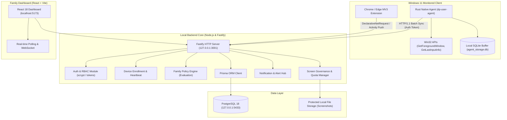

# DigitalPulse — Stage 2 Architecture Specification

## 1. System Overview

DigitalPulse is a Windows-first, privacy-conscious digital activity monitoring, digital wellbeing, and family governance platform.

## 2. Core Subsystems

### 2.1 Rust Desktop Agent (`desktop-agent`)
- **`dp-core`**: Core contracts, domain types, JSON schema serialization.
- **`dp-platform-windows`**: Native Win32 bindings using `windows-sys` and `windows-rs`.
- **`dp-storage`**: Embedded SQLite transaction queue with retry semantics.
- **`dp-ipc`**: Local named pipe protocol for intra-device communication.
- **`dp-user-agent`**: Main user session daemon with HTTP synchronization.

### 2.2 Backend Application (`backend`)
- **Framework**: Fastify 5.x on Node.js 20+ LTS.
- **Authentication**: Salted scrypt password hashing, session tokens, rate limiting.
- **Role-Based Access Control**:
  - `FAMILY_OWNER`: Full household, policy, and device governance.
  - `ADULT_MEMBER`: Self-activity insights, wellbeing goals, consent toggles.
  - `SUPERVISED_MEMBER`: Read-only age-appropriate timeline and time planner.
- **Ingestion Pipeline**: Deduplicating batch receiver (`POST /api/v1/activity/events/batch`).
- **Policy Engine**: In-memory rule cache with sub-millisecond evaluation.

### 2.3 Browser Extension (`apps/browser-extension`)
- **Manifest**: Chrome & Edge Manifest V3.
- **Privacy Core**: `extractDomain` normalizes URLs, aggressively stripping query strings, hash fragments, and credentials.
- **Policy Enforcement**: Dynamically updates `declarativeNetRequest` rules to display soft warning or blocked pages.

### 2.4 Family Dashboard (`apps/dashboard`)
- **Framework**: React 18, Vite, Tailwind CSS, Lucide icons.
- **Theme**: High-contrast, dark-mode design system.
- **Navigation Sections**: Overview, Family Members, Devices, Activity Timeline, App Usage, Web Usage, Screen Monitoring, Time Planner, Wellbeing, Policies, Alerts & Notifications, Privacy & Permissions, Settings.
