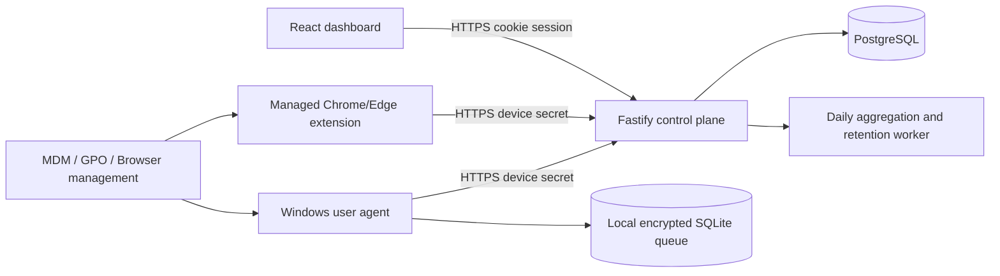

# DigitalPulse final audit

**Audit date:** 4 November 2026  
**Scope:** repository review, static analysis, isolated route probes, and locally runnable checks. No production database, managed browser, Windows installer deployment, or production host was changed. This audit intentionally stops before implementation.

## 1. Executive summary

DigitalPulse has a credible local MVP foundation: a React dashboard, Fastify/Prisma API, a Windows foreground collector with SQLite buffering, and a Manifest V3 extension. The strongest implemented areas are credential-hashed enrollment, schedule-and-consent gating, event idempotency, domain-only extension collection, and a substantial automated test suite.

It is **not ready for production or a broad pilot**. It is suitable for a tightly controlled internal engineering test only after the critical authorization and screen-capture defects below are fixed. The most serious problems are tenant/ownership failures in the screen subsystem, a cross-tenant policy mutation, and an analytics authorization bypass through a client-supplied role. The screen feature should remain disabled for all non-development use until it is redesigned as tenant-scoped persistent data with explicit per-user consent.

The dashboard production build succeeds. JavaScript tests include 108 passes, 4 failures, and 4 intentionally skipped PostgreSQL integration tests. Rust tests pass. The dashboard linter fails. A real PostgreSQL test database, Docker daemon, managed Chrome/Edge device, and a deployed Windows installation were not available.

## 2. Existing architecture

| Layer | What exists | Assessment |
| --- | --- | --- |
| Dashboard | React 19/Vite UI with cookie sessions, role redirects, admin reports, employee portal, setup, devices, invitations and policies. | Partially implemented; production build works but lint fails and employee routes are inconsistent. |
| Backend | Fastify API with Helmet, CORS, opaque hashed sessions, Prisma/PostgreSQL, device-secret authentication, route modules and rate limiting. | Mostly implemented; route-level authorization has material gaps. |
| Data model | Tenant-owned organizations, users, devices, raw events, normalized sessions, enrollment tokens, invitations, policies, notifications and screenshot metadata. | Implemented and schema-valid; no PostgreSQL/RLS verification. |
| Windows agent | Rust user-session agent, foreground/idle detection, local SQLite WAL queue, heartbeat gate, Windows Credential Manager secret storage and WinHTTP. | Substantially implemented but no service lifecycle, installer, updater or managed remote configuration. |
| Browser extension | MV3 background worker, tab/domain tracking, idle events, local queue, authenticated heartbeat/enrollment and dynamic DNR rules. | Partially implemented; suitable for managed deployment only after lifecycle and policy coverage fixes. |
| Deployment | Dockerfiles, Compose and Caddy configuration. | Configuration exists; not deployed or run because Docker Desktop daemon is unavailable. |

The intended activity model is sound: the agent is the source for foreground application and OS idle intervals, the extension provides selected-domain intervals, and the API accepts only credential-authenticated, schedule-authorized batches. The backend unions intervals for high-level active time. It must retain this distinction in all reports: a foreground application, selected tab, browser focus and user input are different facts.

## 3. Feature audit matrix

| Feature | Status | Evidence | Risk / recommended action |
| --- | --- | --- | --- |
| Admin registration/login/session reset | Implemented and tested | `backend/src/modules/auth/auth.service.js`, auth tests | Use production SMTP and PostgreSQL integration tests before release. |
| Invitation and activation | Implemented; DB lifecycle unverified | Auth service and invitation integration test | Test against isolated PostgreSQL and real SMTP. |
| Employee self-enrollment | Implemented and tested in memory | `devices.service.js`; `device-enrollment.test.js` | Validate end-to-end on separate machine and HTTPS host. |
| Enrollment replay protection | Implemented | Hash-only token + transactional `updateMany` claim | PostgreSQL concurrency test remains skipped. |
| Consent/schedule gate | Implemented and tested | `monitoring-authorization.js`; agent/extension gates | Scope schedules consistently to employee timezone; current enforcement uses organization timezone. |
| Desktop app/idle collection | Implemented; hardware-unverified | `dp-user-agent`, `session_manager.rs` | Test sleep, lock, fast user switching and a real user session. |
| Agent offline queue | Implemented and Rust-tested | `dp-storage`, `sync.rs` | Add queue size limits, exponential retry telemetry and crash/restart soak tests. |
| Secure device secret storage | Implemented on Windows | `credential_store.rs` | Verify Credential Manager behavior on supported Windows versions. |
| Windows lifecycle/installer | Missing | `dp-service` logs that it is not active; package scripts create ZIPs | Implement signed MSI/EXE, uninstall, upgrade, per-user startup and visible tray UX. |
| Extension domain tracking | Implemented and tested | MV3 service worker, 24 extension tests | Persist/recover session state and restore domain after idle before production. |
| Extension policy enforcement | Partially implemented | DNR dynamic rules; policy API | Requires managed-browser deployment and coverage reporting; not enforceable across all profiles/devices. |
| Organization policy CRUD | Broken | `policies.routes.js`; isolated cross-tenant PATCH probe | Fix tenant/role/target scope before use. Persist all policy fields. |
| Analytics/report/export | Partially implemented | `analytics.service.js`, dashboard reports | Fix role injection, employee aggregation semantics, pagination and local-time reporting. |
| Screen capture/live sharing | Broken/unsafe for multi-tenant product | `screen.routes.js`, isolated probes | Disable in release until rebuilt with persistent tenant/user/device scope and authorization. |
| Privacy deletion | Implemented and tested | `privacy.routes.js`, privacy tests | Ensure filesystem cleanup happens after the successful transaction (currently it does). Add retention scheduler. |
| Production deployment | Implemented but unverified | Compose/Caddy/docs | Run on isolated host with TLS, PostgreSQL and secret management. |
| CI/CD | Missing | No workflow under `.github/workflows` | Add lint, JS/Rust tests, package verification, dependency/security scan and build artifacts. |

## 4. Admin workflow audit

Registration, login, organization creation and invitation flows exist. Admins can list employees, update schedules, authorize monitoring, issue setup reminders, list devices, view live activity, reports, policies and alerts. Reports offer employee/date filters and CSV export. An administrator can enroll their own device because the employee self-enrollment token endpoint derives organization and user identity from the current session.

Gaps that prevent the intended journey from being complete:

1. Policies have no persistent assignment to employee, device, group, schedule or time zone. `memberId`, `deviceId`, `schedule`, `strictness` and temporary-access configuration are accepted but not stored in `FamilyPolicy`.
2. Policy mutation uses an in-memory lookup and then `prisma.familyPolicy.update({ where: { id } })` without organization scope. An isolated authenticated probe created a tenant-A policy and changed it using a tenant-B admin token with HTTP 200.
3. Policy deletion tries the database delete before confirming the in-memory policy exists; an ID known only to the database can be deleted and the route can still return 404.
4. Device health is based on heartbeat time, but there is no durable health evaluator that raises agent-health, permission, sync-backlog, or enforcement-coverage alerts.
5. Reports call individual daily queries for every day and use UTC date boundaries. They lack team filters, device/application/domain pagination, retention-aware aggregation and a reliable time-zone contract.

## 5. Employee workflow audit

The employee can accept an invitation, sign in, open an employee setup page, download a ZIP, grant monitoring consent, generate a four-hour single-use token, enroll the agent/extension, and view own devices/activity. The setup page clearly states that screenshots and live viewing are separate from ordinary setup. It exposes checksums and verifies downloadable bundles before enabling links.

The workflow is still too technical for a production employee rollout. The Windows path asks the user to extract a ZIP and run PowerShell. Browser installation asks for Developer Mode and “Load unpacked.” Both are suitable for internal testing, not normal employees. The protected route configuration sends employees from `/timeline`, `/digital-wellbeing` and `/settings` to admin-only routes despite showing those links in the employee navigation. The employee portal is the useful minimal page, but working-hours detail, a meaningful support request path, policy/coverage status, and clear remote deployment setup are incomplete.

## 6. Windows agent audit

The agent checks enrollment before collection, stores credentials in Windows Credential Manager, uses SQLite WAL for local sessions and queue state, validates event contracts, batches 50/100 records, handles acknowledged/rejected IDs, and stops collection when heartbeat authorization, consent or schedule fails. It closes sessions on lock, sleep/suspension gaps and shutdown. It uses WinHTTP, disables redirects, has request timeouts, and only allows a remote backend when explicitly enabled and HTTPS.

The executable package smoke test passed: it runs without developer DLLs and keeps its identity/database under `LOCALAPPDATA` across restarts. This is a good portable-test artifact, but is not an installer. `dp-service` is explicitly a placeholder and does not install a service. There is no installer database, signed binary, code-signing process, startup task/registry policy, versioned update feed, rollback, uninstall cleanup, tray application tied to the real agent, or single-instance process lock demonstrated. The compiled configuration defaults to localhost and uses environment variables for remote configuration, which is not appropriate for managed staff endpoints.

Do not implement a hidden service or covert persistence. Use a signed per-machine MSI/EXE with a visible tray/status UI, an explicit organization backend URL, enrollment handoff, uninstall behavior, and documented administrator-deployed startup. Screen recording and screenshots must remain separate optional capabilities, with a separate consent and privacy review.

## 7. Browser extension audit

The extension is MV3 and tracks only normalized domains rather than full URLs. It listens for active-tab, URL, browser-window focus and idle changes; uses an authenticated local queue; stores device secret outside the popup message response; and rebuilds dynamic rules from the API. Its tests verify enrollment races, queue acknowledgement, authorization pausing, domain normalization and stale-rule removal.

The service worker registers listeners only after an asynchronous initialization function completes. Chrome requires handlers to be declared synchronously at global scope for reliable startup dispatch ([Chrome documentation](https://developer.chrome.com/docs/extensions/develop/concepts/service-workers/events)). Further, active-session state is not persisted despite a declared storage key. After worker termination/restart, tracking restarts at the current time and loses an open interval. After `idle` closes a domain session, the `active` event does not restore it unless another tab/focus event occurs; the isolated probe ended with no active session. The local queue is a growing array in `storage.local`, without a cap or IndexedDB spillover.

Dynamic DNR rules can block main-frame navigation in the enrolled browser profile, but the current manifest has only localhost host permissions by default and asks for `https://*/*` optionally. DNR blocks can be removed by a user on an unmanaged browser. It does not control other Chrome/Edge profiles, guest profiles, another browser, native apps, or unmanaged personal devices.

For reliable enterprise enforcement, distribute a signed-store or privately hosted extension through Chrome Enterprise/Google Admin or Edge management/Intune/GPO, force-install it, configure ExtensionSettings, restrict guest/add-person/developer-tools policies as appropriate, and deploy browser URL allow/block policies at the managed-device level. Edge’s `ExtensionInstallForcelist` prevents ordinary users from disabling/uninstalling a force-installed extension ([Microsoft policy reference](https://learn.microsoft.com/en-us/deployedge/microsoft-edge-policies/ExtensionInstallForcelist)); Chrome’s `ExtensionSettings` governs extension installation and overrides related install policies ([Chrome Enterprise reference](https://support.google.com/chrome/a/answer/7532015?hl=en)). The product must show **Managed and enforcing**, **Managed but extension unavailable**, or **Unmanaged / advisory only** rather than claiming universal restriction.

## 8. Backend and database audit

Strengths include opaque hashed sessions, password hashing with `scrypt`, HTTPS/CORS validation in production, origin checks for cookie-changing requests, hashed enrollment tokens, timing-safe device-secret validation, event idempotency on `(deviceId,eventId)`, tenant columns/foreign keys, indexes for major session queries, and error redaction. The Prisma schema validates successfully.

### Verified critical bugs

| Severity | Finding and reproducible evidence | Required correction |
| --- | --- | --- |
| Critical | Screen capture consent, policy, status, live session and audit state are module-global (`screenState`). An employee in tenant A granted screen consent; a tenant-B authenticated request then read `consentGranted: true` from `/screen/config`. | Replace all in-memory screen state with persistent tenant/device/user records; require tenant/device ownership for every route. Disable endpoints until done. |
| Critical | An employee received HTTP 200 for another employee’s screenshot metadata when the row had no `employeeId`; employee access checks permit this shape. | Resolve device owner from the database and enforce it for list, item, preview and delete. Never trust request body employee/device fields. |
| Critical | Screen capture deletion uses only `{ id }`, with no organization predicate; probe showed HTTP 200 and `delete({where:{id}})` for an arbitrary capture. | Read scoped capture first, authorize, then delete in a transaction using organization/device scope. |
| Critical | Any authenticated tenant-B admin PATCHed a tenant-A policy by ID with HTTP 200. | Query policy with `{id, organizationId}` before all read/update/delete/reset operations; prohibit fallback state in production. |
| High | `/analytics/weekly` spreads `req.query` after derived role, allowing `?role=ORG_ADMIN` to override employee scope. Probe returned 200 and unscoped analytics query. | Whitelist query fields; never pass role/user/org from client input. |
| High | Analytics `unionSeconds` merges intervals across all selected employees/devices. Two employees each active for 60 minutes produce `totalActiveMinutes: 60` while category totals are 120. | Define report scope: per employee/device union; organization totals must sum employee-day values and label concurrent-person-hours correctly. |
| High | The screen subsystem uses a fallback encryption key derived from `DATABASE_URL` or a hard-coded string and returns base64 full-screen images in JSON. | Require a dedicated key in production, envelope-encrypt files, stream authorized image bytes, and remove screen capture from default release. |
| High | Policy persistence drops assignment/schedule/strictness/temporary-access fields; edits/deletes rely on memory and can disagree after restart. | Normalize policy/assignment tables; write/read every enforcement field transactionally. |
| Medium | Activity/apps/websites endpoints sum raw durations while summary unions intervals. Browser + desktop time can therefore be double-counted in breakdowns. | Establish source-of-truth attribution: agent interval owns active/idle; extension decorates the overlapping browser interval with domain time, rather than adding a second active total. |
| Medium | Date ranges are UTC, not employee/organization local calendar days. | Make timezone an explicit report parameter derived server-side from organization/employee schedule. |

Other material gaps: no PostgreSQL row-level security; organization filtering is application-enforced; the IP-only in-process rate limiter is not shared across replicas; no automated activity retention/archival task exists; screenshots do filesystem reads/writes synchronously in request handlers; policy enforcement is rules-only and does not support application blocking; and report CSV is capped at 500 rows without a documented continuation/export job.

## 9. Accurate analytics design

Use these immutable facts:

1. The desktop agent emits non-overlapping foreground-app and idle intervals for a device.
2. The extension emits selected-and-browser-focused domain intervals only; it must not claim OS input activity.
3. The backend clips all events to authorization windows and deduplicates by device/event ID.
4. For one employee/device, calculate `observed`, `idle`, and `active` as interval unions. Attach web-domain attribution only within overlapping browser foreground intervals. Report unattributed browser time explicitly.
5. For organization reports, compute each employee/device-day first, then sum those values as person-hours. Do not union separate employees’ timelines.

Store domain only, no paths/query strings/page titles/content. Support organization-configured exclusions and suppress sensitive/internal domains. Materialize daily employee/device summaries asynchronously only after raw-event correctness is established; retain raw events according to a documented retention policy and purge transactionally with audit logs.

## 10. Missing features necessary for a usable product

- Signed MSI/EXE installer, upgrade, uninstall, remote configuration and visible agent/tray lifecycle.
- Managed Chrome/Edge deployment artifacts, stable extension identity/update URL, device-management instructions and enforcement coverage status.
- Tenant-safe persistent screen feature or its explicit removal from the production scope.
- Policy assignment model for groups, employees/devices, schedules, precedence, exemptions and durable enforcement state.
- Correct unified analytics attribution, local-time summaries, scalable queries and report pagination/export jobs.
- Durable health/sync/policy alerts and support workflow.
- Retention scheduler, backup/restore plan, audit-log retention and data-subject deletion verification.
- CI workflow, dependency vulnerability scanning, release signing/provenance and deployment smoke checks.

## 11. Recommended final architecture

Keep a single Fastify service and PostgreSQL for the pilot. Add a small in-process or database-backed job runner only for summaries, retention and health evaluation; do not add Kafka, Kubernetes or microservices. The Windows agent should be per-user for activity collection; a privileged installer/service should only handle update/bootstrap tasks and never collect interactive activity from Session 0. Store installation/management status per device so the dashboard can distinguish advisory extension operation from managed enforcement.

## 12. Implementation roadmap

1. **M1 — Stop critical data exposure (small/urgent):** disable screen endpoints in production; scope policies by organization; remove query-role injection; add regression tests for all probes.
2. **M2 — Policy and consent model (medium):** persistent policy assignments/precedence, per-user consent records, schedule timezone contract, durable audit events.
3. **M3 — Windows lifecycle (large):** signed MSI/EXE, enrollment wizard, tray/status, startup, uninstall, update checks and managed backend configuration.
4. **M4 — Browser reliability (medium):** synchronous listener registration, persisted session/checkpoint state, bounded IndexedDB queue, domain attribution, managed deployment package and coverage reporting.
5. **M5 — Unified analytics (large):** source attribution, per-employee aggregation, local-time daily summaries, indexed paginated APIs and accurate export jobs.
6. **M6 — UX completion (medium):** employee-only routes, setup troubleshooting, support request, admin health/coverage dashboard, clear restriction states.
7. **M7 — Security/performance hardening (medium):** central rate limiting, retention worker, key management, file-streaming access, load tests, backup/restore and dependency review.
8. **M8 — Release validation (large):** isolated PostgreSQL integration suite, managed Chrome/Edge hardware test, signed installer test, staging deployment, pilot acceptance and rollback drill.

Estimated engineering effort: M1 1–2 engineer-weeks; M2 2–3; M3 4–6; M4 2–3; M5 3–5; M6 2–3; M7 2–4; M8 2–4. A focused two-engineer team should plan roughly 10–16 calendar weeks before a controlled pilot, excluding legal/privacy review and enterprise device-management rollout.

## 13. Cost and performance recommendations

Assumptions: 8-hour work day, 30-second heartbeats, 30-second event checkpoints, domain-only web metadata, 30-day raw retention, no screenshots, and 1–3 KB compressed events. At 10/50/100/500 employees, expect roughly 10k/50k/100k/500k daily checkpoints before local aggregation. Batch events, compress at the HTTPS boundary if profiling warrants it, aggregate daily summaries, and retain only raw data needed for audit/reprocessing. A small PostgreSQL instance plus one application host can serve 10–100 employees; 500 employees needs load testing, connection pooling, query plans, partition/retention strategy and background aggregation. Screenshots change the economics dramatically and should be opt-in with quotas and separate storage.

## 14. Test results

| Command / check | Result |
| --- | --- |
| `npm run test:js` | Contracts: 12 passed. Backend: 108 passed, 4 failed, 4 skipped. Dashboard: 32 passed. Extension: 24 passed. |
| Backend failures | Three screen-capture assertions failed after a real PowerShell capture timed out (503 rather than 200); dependent list/delete tests failed. This shows tests are coupled to host capture behavior. |
| Skipped integration tests | Four PostgreSQL lifecycle tests skipped because no isolated `TEST_DATABASE_URL` and `RUN_INTEGRATION_TESTS=true` were supplied. |
| `cargo test --workspace --offline` | Passed: core 13, fixtures 3, IPC 1, Windows platform 6 + 3 integration, storage 5, user agent 4. |
| `npm run build:dashboard` | Passed; Vite built 127 modules. |
| `npm run lint:dashboard` | Failed with React hook/purity/unused-variable errors and warnings across dashboard pages. |
| `npm run verify:employee-downloads` | Passed; ZIP checksums, archive contents and extracted `dp-user-agent.exe` smoke test passed. |
| `prisma validate` | Passed with an isolated dummy URL; schema is valid. |
| Docker deployment | Not run: Docker Desktop Linux daemon is not running. |
| Isolated audit probes | Confirmed cross-tenant policy update, analytics role override, global screen consent, cross-employee screenshot read, unscoped screenshot delete, cross-employee aggregation, and missing extension idle restoration. |

## 15. Final readiness assessment

**Readiness: internal engineering testing only.** Core non-screen telemetry can be evaluated on a small controlled test group after M1 authorization fixes, with transparent consent and company-managed test devices. Do not label the current code production-ready, deploy the screen feature, or claim browser-wide restriction enforcement. A pilot requires M1–M6, the skipped database tests, managed Windows/Chrome/Edge verification, a signed installer, and a staging deployment. Production requires the full security, operations, retention, alerting, backup and release-validation milestones.
